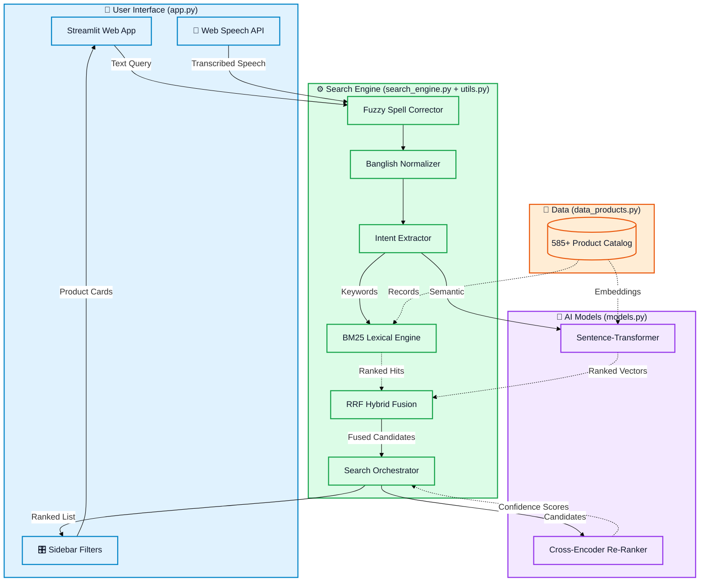

<div align="center">


<br/>

[](https://python.org)
[](https://streamlit.io)
[](https://huggingface.co)
[](https://pytorch.org)
[](data_products.py)
[](LICENSE)

<br/>

> **An AI-powered product search engine that understands what you mean — not just what you type.**  
> Supports **English**, **বাংলা**, and **Banglish** out of the box, with voice search & typo correction built right in.

</div>

---

## ✨ What Makes This Different?

| Feature | Traditional Search | This Engine |
|---|---|---|
| `"comfort wear"` query | ❌ No results | ✅ Finds soft cotton t-shirts |
| Bangla: `"লাল শাড়ি"` | ❌ Fails | ✅ Returns red sarees |
| Banglish: `"kacha morich"` | ❌ Fails | ✅ Finds fresh green chillies |
| Typo: `"wmen bag"` | ❌ No results | ✅ Auto-corrects → finds women's bags |
| Voice in Bengali | ❌ Not supported | ✅ Fully supported |
| Hybrid ranking | ❌ BM25 or semantic only | ✅ **RRF fusion** of both |

---

## 🏗️ System Architecture



---

## 🧠 How It Works — Step by Step

```
User Query ──► Fuzzy Spell Correction ──► Banglish Normalization ──► Intent Extraction
                                                                             │
                                                     ┌─────────────────────┴──────────────────────┐
                                                     ▼                                             ▼
                                          BM25 Keyword Search                    Semantic Vector Search
                                          (Exact + Lexical Hits)           (paraphrase-multilingual-MiniLM)
                                                     └─────────────────────┬──────────────────────┘
                                                                           ▼
                                                       ⚡ Reciprocal Rank Fusion (RRF)
                                                     (merges BM25 rank + cosine rank)
                                                                           │
                                                                           ▼
                                                         Cross-Encoder Deep Re-ranking
                                                        (mmarco-mMiniLMv2-L12-H384)
                                                                           │
                                                       ┌───────────────────┴───────────────────┐
                                                       ▼                                       ▼
                                                 🎯 Top Matches                     💡 Related Products
                                                 (score ≥ 50)                        (score < 50)
                                                       └───────────────────┬───────────────────┘
                                                                           ▼
                                                           Category & Price Sidebar Filters
                                                                           │
                                                                           ▼
                                                               ✨ Product Cards UI
```

---

## ⚡ Tech Stack

<div align="center">

| Layer | Technology | Role |
|---|---|---|
| 🖥️ **Frontend** | Streamlit | Web UI & rendering |
| 🎙️ **Voice** | streamlit-mic-recorder + Web Speech API | Bengali & English voice input |
| 🔤 **NLP / Embeddings** | paraphrase-multilingual-MiniLM-L12-v2 | Dense semantic vectors |
| 🎯 **Re-ranking** | mmarco-mMiniLMv2-L12-H384-v1 | Cross-encoder deep scoring |
| ⚡ **Lexical Search** | Custom BM25 (NumPy) | Keyword exact/partial match |
| 🔀 **Hybrid Fusion** | Reciprocal Rank Fusion (RRF) | Merges BM25 + semantic rankings |
| ✏️ **Spell Correction** | difflib fuzzy matching | Typo tolerance (300+ word vocab) |
| 🔢 **Vectors & Math** | PyTorch, NumPy | Model inference & scoring |
| 📊 **Data** | Pandas | Catalog management & filtering |

</div>

---

## 📁 Project Structure

```
ecommerce-search-app/
│
├── 🚀  app.py                  # Streamlit frontend & UI rendering
├── 🧠  search_engine.py        # RRF hybrid search + cross-encoder orchestration
├── 🤖  models.py               # Model loading & singleton cache manager
├── 🔧  utils.py                # Banglish normalizer, spell corrector, BM25, intent extractor
├── ⚙️   config.py               # Model names, thresholds, scoring constants
├── 🗄️   data_products.py        # 585+ product database (EN, BN, Banglish)
├── 📦  requirements.txt        # Python dependencies
├── 📖  README.md               # You are here
└── 📐  architecture_overview.md # Detailed system architecture docs
```

---

## 🚀 Getting Started

### 1. Clone the Repository
```bash
git clone https://github.com/your-username/ecommerce-search-app.git
cd ecommerce-search-app
```

### 2. Install Dependencies
```bash
pip install -r requirements.txt
```

### 3. Run the App
```bash
streamlit run app.py
```

> 🌐 Opens at **http://localhost:8501**

> ⏳ **First launch note:** AI models (~500MB) are downloaded from HuggingFace on the first run. This takes 1–3 minutes. Subsequent startups are instant.

---

## 🎯 Usage Examples

| What You Type / Say | Language | What It Finds |
|---|---|---|
| `blue nike shoes under 5000` | English | Filtered Nike footwear by color & price |
| `গরুর মাংস` | বাংলা | Beef / meat products |
| `kacha morich` | Banglish | Fresh green chillies |
| `লাল শাড়ি` | বাংলা | Red sarees |
| `gaming laptop` | English | Gaming laptops & accessories |
| `cheler jama` | Banglish | Men's clothing |
| `wmen bag` | Typo | Auto-corrects to "women bag" ✅ |
| `labtop` | Typo | Auto-corrects to "laptop" ✅ |

---

## 🔍 Search Intelligence Details

### Reciprocal Rank Fusion (RRF)
Instead of a fragile `score = 0.6×cosine + 0.4×BM25` linear blend, this engine uses **RRF**:
```
rrf(product) = 1/(60 + cosine_rank) + 1/(60 + bm25_rank)
```
This is **immune to score scale differences** — BM25 scores (0–50) and cosine scores (0–1) no longer interfere with each other. Proven in academic research to consistently outperform linear combinations.

### Fuzzy Spell Correction
Built with Python's `difflib.get_close_matches` against a **300+ word vocabulary** covering every product type, brand, color, material, and category. Bangla text is safely skipped — only English text is corrected.

---

## 📝 License

This project is licensed under the **MIT License** — feel free to use, modify, and share.

---

<div align="center">

Made with ❤️ using Python & Streamlit

</div>
