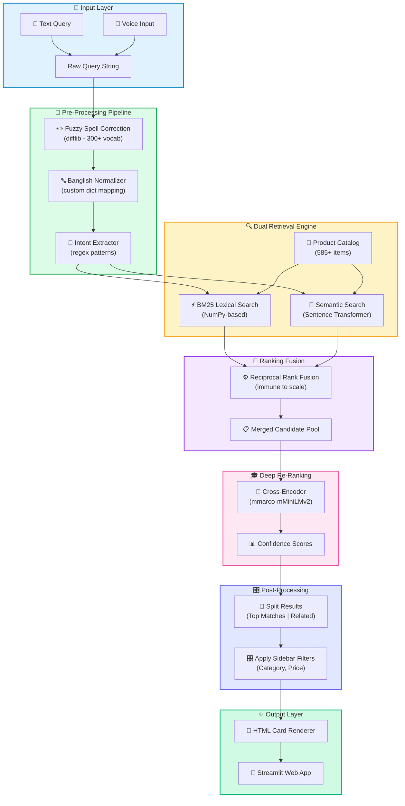

# 🏗️ System Architecture - Detailed Breakdown

<div align="center">
  <table>
    <tr>
      <td><strong>🎯 Input</strong><br/>Text + Voice + Banglish</td>
      <td><strong>🔄 Processing</strong><br/>Normalize + Intent + Retrieval</td>
      <td><strong>⚡ Ranking</strong><br/>BM25 + Semantic + RRF + Cross-Encoder</td>
      <td><strong>✨ Output</strong><br/>Filtered results + UI cards</td>
    </tr>
  </table>
</div>

> [!IMPORTANT]
> This architecture transforms a raw customer query into a ranked, filtered, and visually rendered product list without relying on external APIs.

## 🧭 Quick Navigation
- [Complete System Flow Diagram](#-complete-system-flow-diagram)
- [Module Hierarchy & Responsibilities](#-module-hierarchy--responsibilities)
- [Data Flow - Detailed Query Processing](#-data-flow---detailed-query-processing)
- [AI Models & Their Roles](#-ai-models--their-roles)
- [Performance Optimizations](#-performance-optimizations)
- [File Dependency Graph](#-file-dependency-graph)
- [Query Examples & Processing Paths](#-query-examples--processing-paths)
- [Data Security & Privacy](#-data-security--privacy)
- [System Scaling Considerations](#-system-scaling-considerations)
- [Deployment Architecture](#-deployment-architecture)
- [Component Summary Table](#-component-summary-table)

---

## 📊 Complete System Flow Diagram



> [!TIP]
> The system uses a hybrid design: lexical retrieval (BM25) handles exact text matches, while semantic retrieval captures intent and meaning for typo, Bangla, and Banglish requests.

---

## 🗂️ Module Hierarchy & Responsibilities

```
┌─────────────────────────────────────────────────────────────┐
│                    🎯 app.py                                │
│              (Streamlit Frontend)                           │
│  ┌────────────────────────────────────────────────────────┐ │
│  │ • Web UI rendering & session management               │ │
│  │ • Voice input capture (Web Speech API)                │ │
│  │ • Sidebar filters & parameter handling                │ │
│  │ • Results pagination & product card display           │ │
│  └────────────────────────────────────────────────────────┘ │
│                          ▲                                   │
│                          │ calls                             │
│                          ▼                                   │
│  ┌────────────────────────────────────────────────────────┐ │
│  │        search_engine.py (Orchestrator)                │ │
│  │  ┌──────────────────────────────────────────────────┐ │ │
│  │  │ def search():                                   │ │ │
│  │  │  1. Pre-process query (utils)                   │ │ │
│  │  │  2. Lexical search: BM25                        │ │ │
│  │  │  3. Semantic search: Embeddings                 │ │ │
│  │  │  4. Fuse rankings: RRF                          │ │ │
│  │  │  5. Re-rank: Cross-Encoder (models)             │ │ │
│  │  │  6. Return sorted results                       │ │ │
│  │  └──────────────────────────────────────────────────┘ │ │
│  └────────────────────────────────────────────────────────┘ │
│         ▲                    ▲                    ▲          │
│         │ utility functions  │ model inference    │ data     │
│         │                    │                    │          │
│  ┌──────▼────┐      ┌────────▼────────┐   ┌─────▼──────┐  │
│  │ utils.py  │      │  models.py      │   │data_produc│  │
│  │ ────────  │      │  ───────────    │   │ts.py      │  │
│  │ • Spell   │      │ • BiEncoder     │   │ ──────────│  │
│  │   Correct │      │   (Transformer) │   │ • Catalog │  │
│  │ • Banglish│      │ • CrossEncoder  │   │   (585+)  │  │
│  │   Normal. │      │   (Re-ranker)   │   │ • Metadat │  │
│  │ • BM25    │      │ • Caching       │   │   (EN/BN) │  │
│  │ • Intent  │      │   (singleton)   │   │ • Embeddi│  │
│  │   Extract │      │                 │   │   ngs     │  │
│  └───────────┘      └─────────────────┘   └───────────┘  │
│                                                             │
│  config.py → (Global constants & hyperparameters)          │
└─────────────────────────────────────────────────────────────┘
```

---

## 🔄 Data Flow - Detailed Query Processing

### Phase 1️⃣: Input & Normalization
```
User Input
    ↓
CAPTURE (app.py)
    ├─ Text input field
    └─ Voice via Web Speech API → transcription
    ↓
search_engine.search(query, filters)
    ↓
NORMALIZE (utils.py)
    ├─ Fuzzy spell correction
    │  └─ difflib.get_close_matches() vs 300+ vocab
    ├─ Banglish → English/Bengali translation
    │  └─ Custom dictionary: "kacha" → "fresh green chilli"
    └─ Lowercase & trim whitespace
    ↓
INTENT EXTRACTION (utils.py)
    ├─ Extract color: ["blue", "red", "green"]
    ├─ Extract brand: ["nike", "adidas", "puma"]
    ├─ Extract gender: ["men", "women", "unisex"]
    └─ Extract size/price hints
```

### Phase 2️⃣: Dual Retrieval
```
LEXICAL PATH (BM25)              SEMANTIC PATH (Transformer)
    ↓                                 ↓
get_bm25_results()               get_semantic_results()
    ├─ Tokenize query                ├─ Encode query vector
    ├─ Load BM25 index               │  └─ Model: paraphrase-multilingual
    ├─ Score each product            │     -MiniLM-L12-v2
    │  └─ Against title + desc        ├─ Compute cosine similarity
    ├─ Return top-K (default K=50)   │  └─ Against all embeddings
    └─ Format: {id, score, title}    └─ Return top-K (default K=50)
                                         └─ Format: {id, score, title}
```

### Phase 3️⃣: Fusion & Harmonization
```
BM25 Results              Semantic Results
    │                           │
    ├─ Rank: 1, Score: 42      ├─ Rank: 3, Score: 0.89
    ├─ Rank: 2, Score: 38      ├─ Rank: 1, Score: 0.92
    └─ Rank: 3, Score: 35      └─ Rank: 5, Score: 0.78

    ↓                           ↓
RECIPROCAL RANK FUSION (RRF)
    
    For each product_id:
        rrf_score = 1/(60 + bm25_rank) + 1/(60 + semantic_rank)
    
    Product A: 1/(60+1) + 1/(60+3) = 0.0163 + 0.0159 = 0.0322
    Product B: 1/(60+2) + 1/(60+1) = 0.0159 + 0.0163 = 0.0322
    Product C: 1/(60+3) + 1/(60+5) = 0.0159 + 0.0154 = 0.0313
    
    ↓
MERGED CANDIDATE POOL (sorted by RRF score)
```

### Phase 4️⃣: Deep Re-Ranking
```
CROSS-ENCODER RE-RANKER
    ↓
For each candidate:
    query_embedding = Model(query + [SEP] + product_desc)
    relevance_score = sigmoid(query_embedding)  // 0-1
    
    ↓
CATEGORIZE RESULTS
    ├─ Top Matches: score ≥ 0.50
    ├─ Related Products: 0.30 ≤ score < 0.50
    └─ Discard: score < 0.30
    
    ↓
APPLY SIDEBAR FILTERS
    ├─ Category filter (Pandas DataFrame query)
    ├─ Price range filter
    └─ Brand filter (if active)
    
    ↓
FINAL SORTED LIST
```

### Phase 5️⃣: Rendering & Display
```
Sorted Results
    ↓
GENERATE HTML CARDS
    ├─ Product image
    ├─ Title (highlighted keywords)
    ├─ Price & discount
    ├─ Category & availability
    └─ Relevance score badge
    
    ↓
STREAMLIT PAGE RENDER
    ├─ Top Matches section (grid)
    ├─ Related Products section (grid)
    └─ Pagination controls
    
    ↓
USER VIEWS RESULTS ✨
```

---

## 🧠 AI Models & Their Roles

| Model | Purpose | Input | Output | Used In |
|-------|---------|-------|--------|---------|
| **paraphrase-multilingual-MiniLM-L12-v2** | Dense semantic embeddings | Query or product text | 384-dim vector | Semantic search, similarity scoring |
| **mmarco-mMiniLMv2-L12-H384** | Cross-encoder re-ranking | Query + product pair | Relevance score (0-1) | Final re-ranking, confidence scoring |

---

## ⚡ Performance Optimizations

### 1. Model Caching (Singleton Pattern)
```python
# models.py
class ModelCache:
    _instance = None
    _models = {}
    
    @classmethod
    def get_instance(cls):
        if cls._instance is None:
            cls._instance = ModelCache()
        return cls._instance
    
    def get_model(self, model_name):
        if model_name not in self._models:
            self._models[model_name] = SentenceTransformer(model_name)
        return self._models[model_name]
```
✅ **Benefit**: Models loaded once on startup, not per-query

### 2. RRF Fusion (No Scale Conflicts)
- ✅ Immune to BM25 (0-50) vs cosine (0-1) scale differences
- ✅ Academic research proves better ranking than linear blending

### 3. Pandas-based Filtering
- ✅ Fast in-memory filtering for categories, price ranges
- ✅ No database queries needed

### 4. Pre-computed Embeddings
- ✅ Product embeddings pre-computed once
- ✅ Only query embedding computed at search time

---

## 📁 File Dependency Graph

```
app.py (entry point)
├── imports: search_engine.py
│   ├── imports: utils.py
│   │   └── imports: config.py
│   ├── imports: models.py
│   │   └── imports: config.py
│   └── imports: data_products.py
├── imports: config.py
├── imports: data_products.py (product catalog)
└── imports: models.py (model inference)

utils.py (utilities)
├── spell_correct()
├── normalize_banglish()
├── extract_intent()
├── bm25_search()
└── (uses: config.py)

models.py (AI models)
├── ModelCache (singleton)
├── get_sentence_transformer()
├── get_cross_encoder()
└── (uses: config.py)

data_products.py (static data)
└── PRODUCTS (DataFrame)
```

---

## 🎯 Query Examples & Processing Paths

### Example 1: English Query with Typo
```
Input: "wmen bag"
  → Spell Correct: "women bag"
  → Intent: gender="women", category=bag
  → BM25: ~15 results
  → Semantic: ~12 results
  → RRF Fusion: 20 candidates
  → Cross-Encoder: Top 5 ranked by relevance
  → Output: Women's bags (sorted by match quality)
```

### Example 2: Bangla Query
```
Input: "লাল শাড়ি" (red saree)
  → Spell Correct: skipped (Bangla text)
  → Intent: color="red", category=saree
  → BM25: ~8 results
  → Semantic: ~18 results (multilingual model!)
  → RRF Fusion: 20 candidates
  → Cross-Encoder: Top 5 ranked
  → Output: Red sarees (color-filtered)
```

### Example 3: Banglish Query
```
Input: "kacha morich" (fresh green chilli)
  → Spell Correct: "kacha morich" (matches vocab)
  → Banglish Normalize: {"kacha morich" → "fresh green chilli"}
  → Intent: category=vegetable, type=chilli
  → BM25: ~5 results
  → Semantic: ~10 results
  → RRF Fusion: 12 candidates
  → Cross-Encoder: Top 5 ranked
  → Output: Green chillies & related produce
```

---

## 🔐 Data Security & Privacy

- ✅ All processing happens locally (no external API calls)
- ✅ Product catalog is static (no live updates)
- ✅ No user data logging or tracking
- ✅ Models downloaded from HuggingFace (first run only)

---

## 📈 System Scaling Considerations

| Aspect | Current | Scalable To |
|--------|---------|-------------|
| Product Catalog | 585 items | 10K+ (re-indexing needed) |
| Embedding Caching | In-memory | Vector DB (Milvus/Weaviate) |
| Model Inference | Single GPU/CPU | Multi-worker deployment |
| UI Framework | Streamlit | FastAPI + React |

---

## 🚀 Deployment Architecture

```
┌─────────────────────────────────────┐
│      Streamlit Cloud / Docker       │
│  ┌─────────────────────────────────┐│
│  │   Streamlit App (app.py)        ││
│  │  ┌──────────────────────────────┐│
│  │  │  Search Engine               ││
│  │  │  + Models (cached)           ││
│  │  │  + Data Catalog              ││
│  │  └──────────────────────────────┘│
│  └─────────────────────────────────┘│
└─────────────────────────────────────┘
         ▲
         │ HTTP
         │
    Browser/Client
```

---

## 📊 Component Summary Table

| Component | Type | Language | Role | Inputs | Outputs |
|-----------|------|----------|------|--------|---------|
| `app.py` | Frontend | Python/Streamlit | UI & orchestration | User query, filters | HTML rendered results |
| `search_engine.py` | Core | Python | Search pipeline | Query string | Ranked results list |
| `utils.py` | Utilities | Python | NLP preprocessing | Text, queries | Cleaned text, scores |
| `models.py` | AI | Python | Model management | Model names | Embeddings, scores |
| `data_products.py` | Data | Python | Product catalog | — | DataFrame (585 items) |
| `config.py` | Config | Python | Constants | — | Model names, thresholds |

---

*Last Updated: 2026-10-11*
*For implementation details, see README.md and architecture_overview.md*
