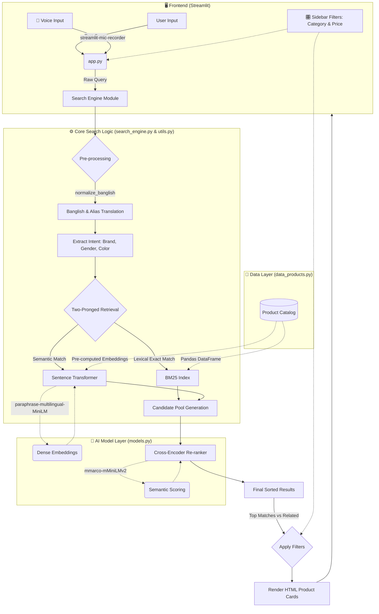

# 🏗️ Intelligent E-Commerce Search - Architecture Overview

This document illustrates the complete data flow and architectural design of the E-commerce Search System.

## High-Level Architecture Diagram

## How It Works (Step-by-Step)

1. **User Input (`app.py`)**: 
   - A user types a search term or uses the **Web Speech API** via the microphone to speak a query (in English or Bengali).
2. **Pre-processing (`utils.py`)**:
   - The system intercepts the query and cleans it. If the user used "Banglish" (e.g. typing *kacha morich* or *shari*), the custom normalization dictionary translates or maps these terms into searchable English/semantic equivalents.
3. **Intent Extraction**:
   - It runs Regex rules to detect intent. If the user searches "blue nike shoes", it automatically detects "blue" (color) and "nike" (brand), ensuring these filters are strictly applied.
4. **Retrieval (`search_engine.py`)**:
   - **Lexical Search**: Uses the **BM25 algorithm** to find exact keyword matches across product titles and descriptions.
   - **Semantic Search**: Uses a **Multilingual Sentence Transformer** to understand the *meaning* of the text, matching products even if the exact words weren't used.
5. **Re-Ranking (`models.py`)**:
   - The candidates from the retrieval phase are pooled together and sent to a **Cross-Encoder Model**. This heavy AI model deeply compares the original query against each product description to assign a highly accurate confidence score.
6. **Filtering & Display**:
   - The results are split into "🎯 Top Matches" (high confidence) and "💡 Related Products" (lower confidence). 
   - Any active Sidebar Filters (like Max Price or Category) are applied locally via Pandas.
   - The final results are rendered as beautiful, hoverable HTML cards in the UI.
